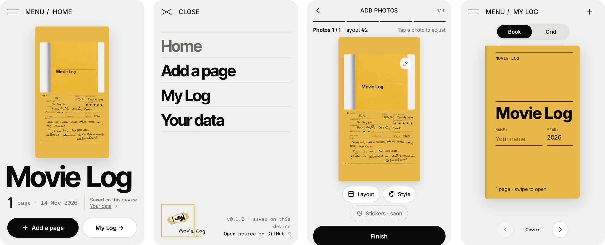
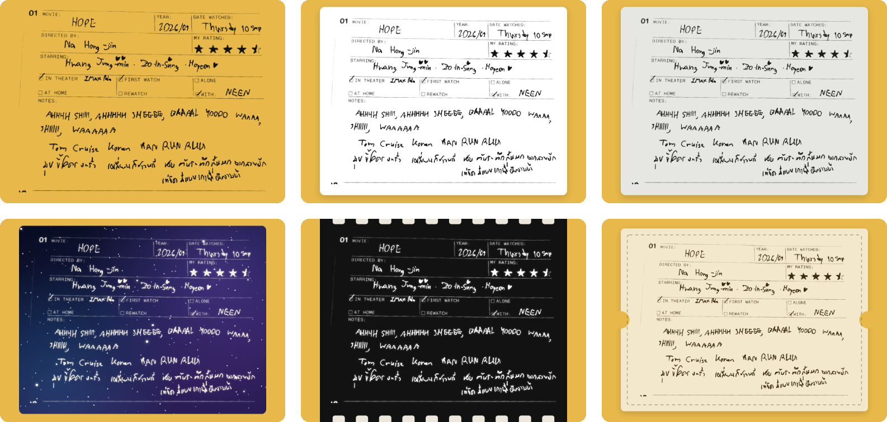
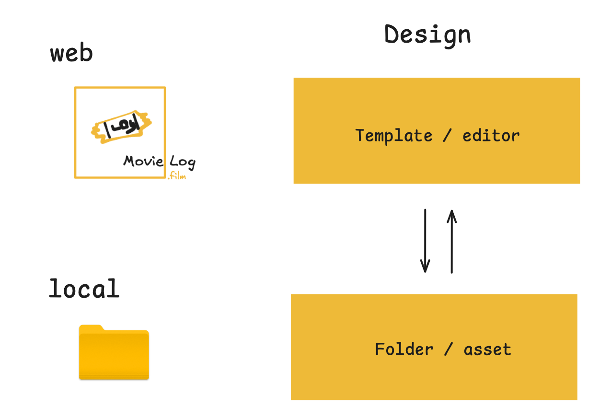

<p align="center">
  
</p>

<p align="center">
  <b>Turn the pages of your handwritten movie log into Instagram Stories.</b><br />
  No account. No server. Everything stays on your device.
</p>

<p align="center">
  
</p>

---

## The idea

A friend brought back an A24 **Movie Log** book from a work-and-travel trip, and every film we watch gets a handwritten page. Movie Log .film turns those pages into Stories you can share, and keeps them in a book you can flip through, like an album.

It works like [Excalidraw](https://excalidraw.com/): open the site and start, with no sign-up. Your pages live in your browser, and you can export them or save them to a folder whenever you want.

## Overview

<p align="center">
  
</p>

1. **Capture**: take a photo of a log page, or upload one (a sample page is included).
2. **Select a review**: the photo is straightened, the review boxes on the page are found, and the paper is removed so only the ink is left. Pick a box and drag its corners if needed.
3. **Choose a layout**: four Story layouts that size themselves to your review.
4. **Style and photos**: pick a card style and text colour, add your own photos, move and zoom them.
5. **Share and keep**: get a 1080 × 1920 PNG to share or download. It also flies into **My Log**.

## Card styles

<p align="center">
  
</p>

**Clear · Paper · Gray · Space · Film · Ticket**, each with any text colour (or keep the real pen colour).

## How the data works

<p align="center">
  
</p>

| Where | What |
|---|---|
| **Web** | The whole app runs in the browser: capture, detection, editor, rendering. |
| **Local** | Pages are saved in the browser (IndexedDB). Export or import a `.movielog` backup at any time, or save every page as PNG plus `log.json` into a folder (Chrome / Edge on desktop). |

Nothing is uploaded anywhere.

## Brand

The site follows the look of the A24 shop's Movie Log page: a quiet gray page, big tight headlines, small details set in mono, and a `☰ MENU / PAGE` header. The hand-drawn ticket logo brings the yellow.

| Token | Value | Use |
|---|---|---|
| Background | `#F0F0EE` | page |
| Ink | `#0A0A0A` | text, primary buttons |
| Muted | `#6B6B65` | secondary text |
| Yellow | `#E8B94A` | logo, Story background, highlights |
| Display font | Inter Tight 700 | headlines |
| Body font | Inter · IBM Plex Sans Thai | text |
| Mono font | DM Mono | counts, dates, labels |

Logo files: `static/brand/logo.png`, icons in `static/`.

## Develop

Needs Node 24 (see `.nvmrc`).

```sh
nvm use
npm install
npm run dev -- --host   # --host lets a phone on the same Wi-Fi open it
```

```sh
npm run check   # type check
npm run build   # static site in build/
```

Built with SvelteKit (static adapter). Image processing is plain Canvas code in the browser.

```
src/lib/imaging.ts     deskew, box detection, ink extraction, story rendering
src/lib/templates.ts   story layouts (1080 × 1920, Instagram safe area)
src/lib/themes.ts      card styles and ink colours
src/lib/db.ts          My Log storage (IndexedDB)
src/lib/files.ts       share, download, backup, save to folder
src/routes/            Home, Add, My Log, Your data
```

## Roadmap

- [ ] Stickers on the Story
- [ ] Two-way sync with a local folder
- [ ] Better box detection for tricky photos (OpenCV.js)
- [ ] Hosted version on Vercel

## License

[MIT](LICENSE)
